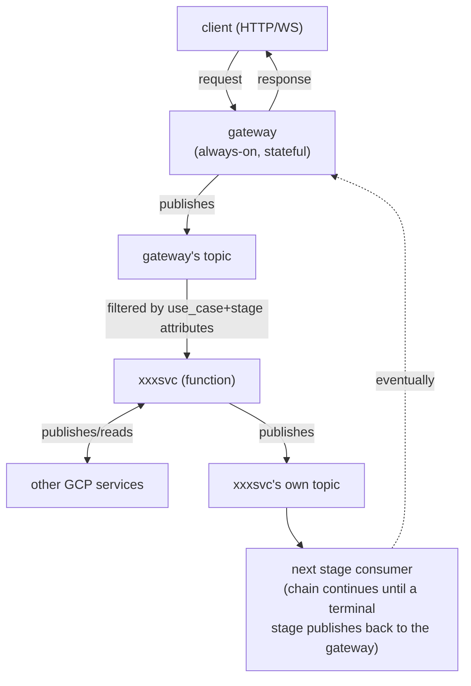
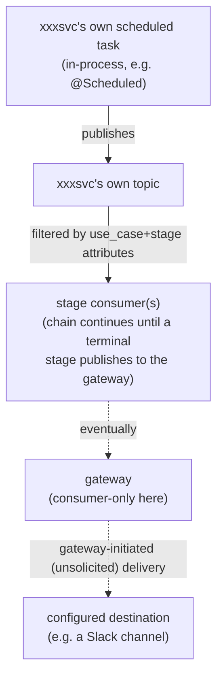

# Architecture

## Overview

This repo is a mono-repo of independently deployable services that together process work
asynchronously via GCP Pub/Sub. There is exactly one always-on, stateful service (the gateway);
everything else is event-driven and, other than the gateway, expected to be deployable as a
Cloud Run Function.

A use case — one chain of asynchronous processing, identified by a `use_case` value — originates
one of two equally valid ways:

1. **A caller request**, received by the gateway, which holds that caller's connection open until
   the chain's terminal message returns.
2. **A service's own scheduled task**, running in-process inside a non-gateway service, with no
   caller and no connection to hold open.

Both use the same envelope, the same `use_case`+`stage` filtering, and the same idempotency rules;
they differ in who mints the `request_id`, and in how the chain's terminal message is delivered.

### Two ways a use case originates

**Caller-originated** — the gateway receives a request and holds the connection open until the
chain returns to it:

**Scheduled-task-originated** — a service's own in-process scheduled task starts the chain; the
gateway is consumer-only and pushes the terminal message to a configured destination:

The two paths share every stage in between; only the origin and the terminal delivery differ. See
"Scheduled-task-originated use cases" and "Gateway-initiated (unsolicited) delivery" below.

### Components

- **gateway** (`gateway-svc`): the only always-online service, and the system's egress point for
  every chain's terminal message. For a caller-originated use case it accepts the inbound request
  (HTTP, WebSocket, Slack, etc.), assigns a `request_id` (UUID), and is responsible for eventually
  delivering a response back to whichever caller made the original request — regardless of what
  form that caller's connection took. For a scheduled-task-originated use case, see
  "Scheduled-task-originated use cases" below.
- **functions** (`xxxsvc`): each is a Cloud Run Function that reads from one Pub/Sub subscription
  and (optionally) writes to one or more Pub/Sub topics. Side effects are allowed and expected
  inside a function (see "Side effects in functions" below).
- **claude-automator**: a special, non-FaaS event-driven service (long-running Node/TS process),
  not deployed as a Cloud Run Function. It participates in the same message-based flow as any
  other consumer/publisher. **One running instance serves every use case that names it** — see
  "claude-automator: multi-use-case dispatch" below — rather than one deployment per use case.
- **other GCP services**: a catch-all box that the gateway and any function may depend on for
  side effects (Firestore, Cloud Storage, Secret Manager, Cloud Tasks, etc.) — omitted from
  individual sequence diagrams to avoid clutter; see "Side effects in functions."

All processing beyond the originating service's first publish is asynchronous: the chain — whenever
and via however many intermediate stages it takes — eventually arrives at the gateway as another
message, keyed by `request_id`.

### Scheduled-task-originated use cases

This is the second of the two origination patterns introduced above. Such a use case has no caller:
it is originated by an in-process scheduled task (e.g. a Spring `@Scheduled` method) running inside
a non-gateway service — e.g. `article-svc` periodically polling an RSS feed. There is no separate
scheduler component or deployable; the scheduled task is ordinary code inside that service, which is
the one that originates the use case. The rules specific to this pattern:

- **`request_id` is originated by whichever service starts the chain.** For a use case originated
  by a service's own scheduled task, that's the service the task runs in, not the gateway — it
  mints the UUID and stamps it on the first message it publishes. Everything downstream (envelope
  shape, `use_case`+`stage` filtering, idempotency-by-`request_id`+`stage`) is identical across both
  origination patterns; only the origin differs.
- **The gateway is consumer-only for such a use case.** It never registers a `request_id` in its
  callback registry for one, because it never received an inbound request to hold open. When the
  terminal message of the chain reaches the gateway, there is no pending registration to look up —
  see "Gateway-initiated (unsolicited) delivery" below for how the gateway still acts on it.
- **The gateway's per-use-case timeout does not apply to the originating end.** The timeout
  mechanism described below exists to fail a *held-open caller connection* that never got its
  answer. A service's internal scheduled task isn't holding a connection open, so there is nothing
  to synthesize a failure response into — a stuck/failed chain is only visible as a processing
  failure (nack → retry → DLQ) at whichever stage got stuck, or as an absence of the expected
  terminal delivery, observable only via logs/metrics. This is a deliberate, narrower
  failure-visibility story than the gateway-originated case; revisit if a use case needs an
  explicit stuck-chain alarm (see `backlog.md`).
  - **This includes the terminal delivery itself.** The failure most likely to go unnoticed is not
    a stuck mid-chain stage but a *failed final delivery* — the chain completed, the gateway got
    the terminal message, and the external send (e.g. the Slack post) failed. That nacks,
    redelivers, and dead-letters like any other stage failure, but for a caller-originated use case
    the caller's timeout would still surface something to a human, whereas here nothing does: no
    caller, no timeout, and a DLQ nobody is watching. Treat DLQ depth on the gateway's terminal-stage
    subscription as the observable signal for these use cases; wiring an actual alert on it is
    deferred with the rest of observability (see `backlog.md`).
- **Deduplication against a rerun scheduled task is the originating service's responsibility.** If
  a task's next tick fires before a prior chain finishes (or reprocesses the same source item),
  nothing downstream deduplicates by business meaning (e.g. "same article") — only by
  `request_id`+`stage`, and a rerun mints a new `request_id`. Avoiding duplicate terminal effects
  (e.g. two Slack posts for the same article) is the originating service's design concern, not the
  gateway's or any mid-chain function's.

## The gateway

- The only stateful service in the system, and the only one required to be always-online (needed
  to support WebSocket and long-poll connections).
- On receiving a request, generates a `request_id` (UUID) and registers it in an in-memory
  `request_id → callback` map, then publishes the first message of the use case.
- A "callback" is deliberately abstract — it may be a long-polling HTTP response held open, an
  HTTP callback URL the caller supplied, a WebSocket send, a Slack `response_url` POST, etc. New
  callback kinds can be added without changing the gateway's core registry/timeout/shutdown
  logic.
- When a message arrives on the gateway's inbound subscription carrying a known `request_id`, the
  gateway looks up the registry entry, invokes the callback, and removes the entry.
- **Current implementation note**: the registry is in-memory only (single gateway instance
  assumption). Distributed/persistent callback handling is intentionally deferred — see
  `backlog.md`.

### Gateway-initiated (unsolicited) delivery

The registry/callback model above applies only to caller-originated use cases — a
scheduled-task-originated one never registers a callback (see "Scheduled-task-originated use cases"
above) and needs a different delivery mode at its terminal end.

The gateway therefore has a second, narrower delivery mode alongside the registered-callback one: a
**direct/unsolicited delivery** that acts on a terminal message without any prior registration to
look up. Key properties, kept distinct from the callback model rather than stretched to fit it:

- **No registration, no TTL, no expiry.** Nothing is registered ahead of time and nothing needs to
  be evicted — this should be its own, simpler concept from the registered-callback path, keyed
  only on `use_case`+`stage`, not `request_id`.
- **The destination is static config, not supplied by the request or looked up at runtime.** The
  existing (registered-callback) Slack path derives its destination from the inbound request that
  started the chain; a gateway-initiated push has no such request, so it instead reads its
  destination (e.g. a Slack channel) from the gateway's own configuration, declared per use case and
  set up ahead of deploy — not a database/cache lookup. The set of scheduled-task-originated use
  cases is small and only changes at deploy time, matching how topic/subscription wiring already
  works; revisit only if that stops being true.
- **Uses a standing-credential send, not a callback-URL send.** For Slack, that means the gateway's
  Slack app posting via a bot-token-authenticated call to a configured channel, a different
  mechanism from a callback-URL send that only works within that callback's validity window and
  against the channel that invoked it.
- **No failure delivery.** Because there is no caller connection to fail, a use case using this
  delivery mode has no failure-response leg — see "Scheduled-task-originated use cases" above.
- **Duplicate suppression is this path's own responsibility, and it is the one piece of state it
  needs.** Pub/Sub is at-least-once, so the gateway can receive the same terminal message twice
  (ack deadline expiry, or a crash after the external send but before the ack). On the
  registered-callback path this is absorbed for free — the registry entry is removed on first
  completion, so a redelivery finds nothing to invoke. A stateless `use_case`+`stage` handler has
  no such protection, and unlike the rerun-a-scheduled-task case above, the originating service
  **cannot** prevent this: the duplicate is created downstream of it, from one single message it
  published once. Left unaddressed, the visible failure is a Slack channel showing the same summary
  twice.

  The gateway must therefore deduplicate deliveries by `request_id` on this path — remembering the
  `request_id`s it has already delivered for long enough to cover Pub/Sub's redelivery window, and
  skipping (but still acking) a repeat. This is the reason `request_id` remains mandatory on a
  chain that has no caller to correlate back to. Note this is *suppression, not a guarantee*: the
  crash-after-send-before-ack window and, under the current in-memory design, a gateway restart both
  remain genuinely at-least-once. Making the dedup store survive a restart is the same open question
  as the in-memory callback registry, and is deferred with it — see `backlog.md`. What is decided
  here is that duplicate suppression belongs to the gateway on this path, not to the originating
  service; the storage mechanism is gateway-svc's own service-level design call.
- **Generic, not Slack-specific.** This is documented here as a gateway capability so a future
  use case can reuse it against a different destination (another channel, a webhook, etc.) without
  redesigning the mechanism — only the destination adapter changes.

Concrete code-shape notes (existing gateway classes, exact Slack call) are implementation detail for
gateway-svc's own service-level design, not this doc — see `gateway-svc/docs/draft-notes.md`.

### Per-use-case timeout

Every use case must declare a timeout. The gateway starts a timer when it registers a
`request_id`; if no terminal message arrives before the timeout elapses:

1. The gateway synthesizes a failure response and delivers it through the same callback mechanism
   as a real response.
2. The gateway removes the `request_id` entry from its registry.

This is the sole failure-detection mechanism for a stuck/failed mid-chain function today — there
is no dedicated "error" message stage (see `backlog.md` for a possible fast-fail short-circuit).

### Graceful shutdown

Configured via `application.yaml`, three stages:

1. **Drain**: the gateway stops accepting new requests but keeps running, waiting up to a
   configurable duration for in-flight `request_id`s to receive their real response.
2. **Force-fail in-flight**: for every `request_id` still pending after the drain window, the
   gateway immediately fires that request's failure response (same synthesized-failure path as a
   timeout) and cleans up the registry entry.
3. **Forced shutdown**: the process exits (or the platform sends `SIGKILL` after its own grace
   period, e.g. Cloud Run's SIGTERM→SIGKILL window).

A newly started gateway instance has an empty registry. If it receives a response message for a
`request_id` it never registered (e.g. because the previous instance shut down and this is a
stale/duplicate redelivery), it logs a warning and discards the message. This is a deliberate,
accepted gap under the current in-memory/single-instance design — see `backlog.md`.

**This discard rule applies only to the registered-callback path.** An unsolicited-delivery use
case never registers a `request_id` at all, so every one of its terminal messages would trivially
satisfy "a `request_id` I never registered" and be discarded. The gateway must therefore decide
which delivery mode applies **first**, from the message's `use_case`+`stage`, and only fall through
to the registry lookup (and this discard rule) for use cases that use the registered-callback mode.
A terminal message whose `use_case`+`stage` matches a configured unsolicited-delivery entry is
never subject to the registry-miss discard.

## Functions

- Each function is triggered by messages on the Pub/Sub subscription(s) it owns, and may publish
  to zero, one, or multiple downstream topics (fan-out to multiple next stages is allowed).
- **Idempotency is required**: given the same `request_id` + `stage`, reprocessing a message must
  produce the same outcome (no duplicate downstream publishes, no duplicated external side
  effects). This is necessary because Pub/Sub delivery is at-least-once.
  - **Exception: claude-automator.** Any function whose side effect is an LLM call cannot
    guarantee an identical output on reprocessing — the LLM will not return byte-identical
    results, only interchangeable ones. Such functions are exempt from output-identity, but must
    still be *safe to retry*: reprocessing must not duplicate downstream publishes or otherwise
    double-apply side effects that aren't idempotent by nature.

### Side effects in functions

Side effects are expected and encouraged inside a function. Beyond calling external APIs and
writing to databases, other side effects a function may perform:

- Publish to multiple downstream topics (fan-out).
- Call any **other GCP service** for information or storage (Firestore, Cloud Storage, Secret
  Manager, etc.) — modeled as a single dependency block in diagrams, since gateway and every
  function may reach it.
- Enqueue a delayed/scheduled continuation via **Cloud Tasks** for a business-logic-driven delay
  (e.g. "poll this external async job again in 30s") — distinct from Pub/Sub's transient-failure
  redelivery. A function creates a one-time Cloud Task with a future `scheduleTime` targeting its
  own HTTP entrypoint. Not yet used by any use case; the full pattern and its trigger condition
  live in `backlog.md`.

## claude-automator: multi-use-case dispatch

claude-automator is **one running instance serving every use case that registers with it** — not
one deployment per use case. `QA` is the first registered use case under this model, not a special
case: unchanged in behavior, just re-expressed as the first entry in a per-use-case registry.

### Consumption shape: multiple subscriptions, one instance, polled concurrently

claude-automator owns **one Pub/Sub subscription per registered use case's inbound stage**, not one
subscription with an OR-style filter spanning use cases. The single running instance pulls from all
of its owned subscriptions concurrently — the concurrency mechanism itself (e.g. one poll loop per
subscription vs. some other structure) is this service's own implementation call, not fixed here;
see `claude-automator-dev/docs/draft-notes.md` for a starting sketch.

This follows directly from the existing ownership rules in
[`arch/topics-and-provisioning.md`](arch/topics-and-provisioning.md) — **no convention change is
needed there**, only an example update showing one consumer owning multiple subscriptions against
different publishers:

- A single subscription binds to exactly one topic. `QA`'s inbound messages are published by the
  gateway on `gateway-requests`; `ARTICLE_SUMMARY`'s are published by `article-svc` on
  `article-svc-requests` — two different topics owned by two different publishers. An
  attribute-filter OR across `use_case` values cannot bridge two different topics, so a single
  subscription could never cover both regardless of filter syntax. Multiple subscriptions is not a
  stylistic choice here; it's the only shape that fits two different upstream publishers.
- "A subscription is owned by its consumer" already permits a consumer to own as many subscriptions
  as it needs. claude-automator gains a second owned subscription (against `article-svc-requests`,
  filtered to `use_case="ARTICLE_SUMMARY" AND stage="SUMMARIZE_REQUESTED"`) the same way the gateway
  already owns subscriptions against more than one publisher's topic — this is an existing pattern,
  not a new one.
- Each subscription keeps its own filter, its own DLQ (per the one-DLQ-per-subscription rule), and
  its own idempotent ack/nack lifecycle — a poison message on the `ARTICLE_SUMMARY` subscription
  dead-letters independently of the `QA` subscription's traffic.

### Publishing shape: still one outbound topic

claude-automator remains **one publishing service**, so the "1 topic per publishing service"
convention is unchanged: all registered use cases' outbound messages publish to the same single
`claude-automator-responses` topic, distinguished by their `use_case`/`stage` attributes exactly
like any other multi-use-case topic in this system. `ARTICLE_SUMMARY`'s `SUMMARIZED` messages do
**not** get a topic of their own — a consumer (the gateway, for both `QA` and `ARTICLE_SUMMARY`
today) adds one subscription per use case it cares about against this one topic, each with its own
filter and DLQ, same as always.

### Per-use-case dispatch: resolving prompt + inbound/outbound stage per message

Today's behavior is hardcoded to `QA` alone (see `backlog.md` for exactly where in the code). That
must become **data-driven per registered use case**: for each inbound message, claude-automator
needs to resolve, from which subscription it arrived on, what prompt to hand the agent and what
`use_case`/`stage`/topic to publish the result to — with `QA` becoming the first such entry,
byte-for-byte equivalent to its current hardcoded behavior. The concrete config shape (a literal
registry table, code-defined, or otherwise) is this service's own design call, not fixed here; see
`claude-automator-dev/docs/draft-notes.md` for a starting sketch.

### Blast radius of sharing one topic and one instance

Sharing has two consequences worth stating explicitly, since neither existed when `QA` was the only
use case:

- **The outbound topic's schema is now shared across use cases.** `claude-automator-responses`
  carries every registered use case's results under one attached envelope schema, so a schema
  revision that one use case needs is a change to the envelope every other use case on that topic
  also publishes. The additive-only evolution rule in [`arch/messaging.md`](arch/messaging.md)
  already makes this safe — but it is now load-bearing rather than theoretical, because a removed or
  renumbered field would break a use case whose owner never asked for the change.
- **One process means shared resource limits.** Registered use cases differ substantially in
  message size: `QA` carries a short question, while `ARTICLE_SUMMARY` carries article content
  fetched from arbitrary third-party feeds, which is both far larger and not under our control.
  Pub/Sub's per-message size limit therefore becomes a real failure mode for the first time, and it
  fails at *publish* time in the originating service (see `arch/messaging.md` — a publish failure is
  a processing failure of whatever that service was handling). Bounding or truncating oversized
  content before publishing is the originating service's responsibility, not claude-automator's;
  claude-automator is not required to defend against it, but should not assume inbound payloads are
  QA-sized.

### What this does not change

- The shared envelope (`use_case`, `stage`, `request_id`, `payload`, `metadata`), schema
  enforcement, and idempotency/retry rules are unchanged and apply per registered use case exactly
  as they do today for `QA` alone.
- claude-automator's LLM-output-identity exemption (see "Functions" above) still applies uniformly
  across every registered use case.
- This section specifies requirements claude-automator must meet, not its concrete implementation —
  that is this service's own design and implementation, reopened by this change (see `PIPELINE.md`).

## Conventions (detail docs)

The message contract and the Pub/Sub wiring conventions live in their own docs under `arch/` so
this page stays focused on the system model. Read them when building or provisioning a stage:

- [`arch/messaging.md`](arch/messaging.md) — the shared message envelope, Protobuf/Pub-Sub schema
  enforcement (validation happens at publish time), and schema-evolution rules.
- [`arch/topics-and-provisioning.md`](arch/topics-and-provisioning.md) — topic/subscription/DLQ
  ownership and naming, and the per-service `provision-pubsub.sh` convention (each service
  provisions only what it owns).

## Accepted risks / not yet solved

- **A/B/C never share a database.** Stages in a use case are assumed not to have cross-stage data
  races since they don't share storage; this is accepted as a risk rather than actively verified.
  Tracked in `backlog.md`.
- **In-memory callback registry.** The gateway's `request_id → callback` map is not persisted or
  distributed. A gateway restart loses in-flight registrations (mitigated somewhat by the
  graceful-shutdown drain/force-fail sequence above, but a hard crash still loses state).
  Distributed/persistent handling is deferred — see `backlog.md`.

See `backlog.md` for the full roadmap and known gaps against this design.
