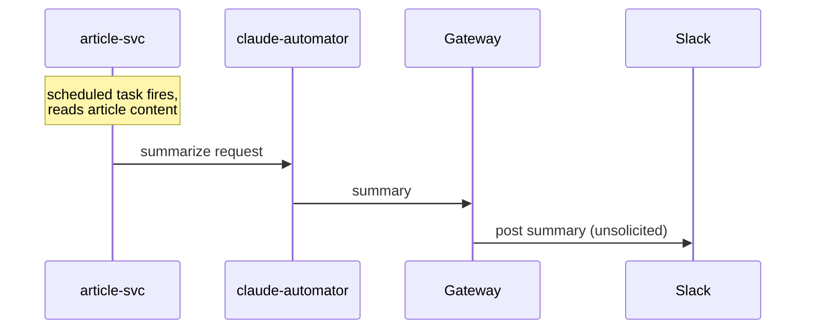

# Use case: Article summary

- `use_case` value: `ARTICLE_SUMMARY`
- Timeout: 300000 ms (5 minutes) — same as `QA` for now, no data yet to justify a different number;
  revisit once this use case has run in practice. Log-only, no failure delivery — see
  "Scheduled-task-originated use cases" in `../architecture.md`.
- **Originates in `article-svc`, not the gateway** — a scheduled task, not a caller request. See
  "Scheduled-task-originated use cases" in `../architecture.md`.
- **Ends with gateway-initiated (unsolicited) delivery to Slack, not a registered callback** —
  nothing was waiting on this `request_id`. See "Gateway-initiated (unsolicited) delivery" in
  `../architecture.md`.
- **Served by the same `claude-automator` instance as `QA`**, as an additional entry in its
  per-use-case registry — not a second deployment. See "claude-automator: multi-use-case dispatch"
  in `../architecture.md`.

## Sequence diagram

## Stages

| Publisher | Subscriber | use_case | stage |
|---|---|---|---|
| article-svc | claude-automator | `ARTICLE_SUMMARY` | `SUMMARIZE_REQUESTED` |
| claude-automator | gateway | `ARTICLE_SUMMARY` | `SUMMARIZED` |

The article's content and the fixed "summarize" prompt instructions are carried in the envelope's
`payload`/`metadata` fields on the first hop; the resulting summary is carried similarly on the
second hop. Exact field split (`payload` vs `metadata`) is left to `article-svc`'s and
`claude-automator`'s service-level design, same as `QA`'s.

## Topics and subscriptions

Each service provisions only the infrastructure it owns (see
`../arch/topics-and-provisioning.md`): its own outbound topic + DLQ, and its own subscription
against whichever topic it consumes. **Only one new topic is required** — `article-svc-requests`,
for `article-svc`'s outbound "please summarize" messages. The `SUMMARIZED` leg reuses the existing
`claude-automator-responses` topic (claude-automator stays one publishing service — see
"claude-automator: multi-use-case dispatch" in `../architecture.md`): the gateway adds a second,
new subscription against that existing topic, its existing `QA`-filtered subscription untouched.

Concrete subscription/DLQ names, run order, and the schema-registration step are left to the
`article-svc`/`claude-automator`/`gateway-svc` service-architect and implementer passes — see
`article-svc/docs/draft-notes.md` for a starting sketch.

## Known gaps for this use case

Tracked in `../backlog.md`, not repeated here: gateway-initiated delivery is designed but not yet
implemented (including its two easy-to-miss requirements — delivery-mode dispatch must run *before*
the registry lookup, or every message on this use case's terminal leg is discarded as an unknown
`request_id`; and duplicate suppression by `request_id` on that path); DLQ-depth alerting (this use
case's only failure signal, including a failed terminal Slack post); residual duplicate-delivery
exposure that dedup suppresses but cannot eliminate; unbounded third-party article content against
Pub/Sub's message-size limit; and claude-automator's multi-use-case dispatch being designed but not
yet implemented.

Two use-case-specific judgment calls, not generic gaps, so not in `../backlog.md`:

- **A duplicate Slack post is accepted as cosmetic**, not a correctness failure, for this use case
  specifically. Note the gateway is still required to suppress duplicates by `request_id` (see
  "Gateway-initiated (unsolicited) delivery" in `../architecture.md`) — what's accepted here is the
  residual leak that suppression can't close (a crash between the Slack post and the ack, and, under
  today's in-memory store, a gateway restart), not an excuse to skip dedup.
- **Dedup against a rerun scheduled task** (e.g. the same article processed twice) is `article-svc`'s
  own responsibility, per "Scheduled-task-originated use cases" in `../architecture.md` — left to
  its service-level design (e.g. a per-article dedup key).
